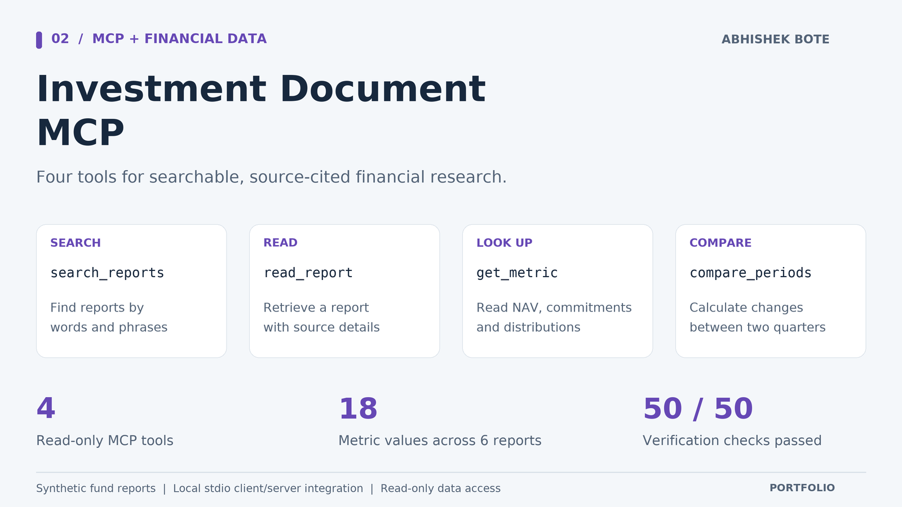

# Investment Document MCP



Built by [Abhishek Bote](https://github.com/InfinityAbhi).

A local Python prototype that exposes investment-document lookup through the Model Context Protocol (MCP). It provides four read-only tools over six synthetic reports for three fictional funds across two quarters.

The working client and server demonstrate protocol integration, bounded data access, source traceability, and evaluation of deterministic financial calculations. This is not a prior employer deployment or a live investment product.

## Run locally

Python 3.12 was used for verification. From this directory:

```sh
python3 -m venv .venv
.venv/bin/python -m pip install -r requirements-lock.txt
.venv/bin/python demo.py
.venv/bin/python verify.py
```

The six fixtures and their manifest are committed as files. To recreate the same fixtures, run `.venv/bin/python make_fixtures.py`. No API keys, model account, database server, or paid cloud resources are needed. Package installation needs network access; the demo and verification run locally.

## Tools

| Tool | Input | Result |
| --- | --- | --- |
| `search_reports` | Query and optional result limit | Matching report excerpts and source references |
| `read_report` | Known document ID | Complete report text, source ID, and SHA-256 |
| `get_metric` | Fund ID, quarter, metric | Reported USD amount with a source citation |
| `compare_periods` | Fund ID, start/end quarter, optional metric | Amount change and percentage change with both citations |

Supported metrics are `nav_usd`, `commitments_usd`, and `distributions_usd`. Search uses all query words, with parameterized SQL against an in-memory SQLite index. It is lexical retrieval, not vector retrieval or LLM reasoning. `synthetic://reports/...` values are citation identifiers, not registered MCP resource endpoints.

## Example result

The demo connects a real MCP client to the server over stdio, discovers the tools, searches for Harbor Credit, reads a report, retrieves Q2 NAV, and compares Q1 with Q2. The synthetic NAV changes from $120,000,000 to $126,000,000, a $6,000,000 increase or 5.00%. The result includes both source documents, their hashes, and the dataset version. A change in reported NAV is not a total investment return.

`demo.py` invokes this sequence explicitly. It does not use an LLM to decide which tools to call. A tool-capable AI host can separately connect to the same stdio server, but that host integration has not been tested here.

## Verified result

The completed local run passed **50 of 50 named checks** using **51 MCP tool calls**, including all four tools, all six reports, and 18 metric lookups. The machine-readable report also records the source-code hashes and negotiated protocol version. Run `verify.py` again after changes; counts apply to the checked version and fixed dataset.

## Implementation

- `server.py`: MCP server, tool annotations, strict input schemas, and safe tool errors.
- `report_store.py`: fixed-format report ingestion, manifest verification, read-only SQLite index, and Decimal percentage calculations.
- `data/`: six text reports plus a versioned SHA-256 manifest.
- `demo.py`: working stdio client workflow covering all four tools.
- `verify.py`: automated protocol, lookup, calculation, validation, and fixture-integrity checks.
- `evaluation/verification.json`: machine-readable output from the latest verification run.

The tools return JSON text through MCP TextContent. They do not currently declare an output schema. Input schemas and read-only tool annotations are advertised through MCP discovery.

## Reliability and boundaries

The server accepts known identifiers rather than file paths, rejects invalid periods and metrics, bounds query length and result count, and prevents manifest path escapes or symlinks. It verifies document hashes before indexing and sets SQLite to query-only mode. Unknown data returns an error rather than an invented value. A zero baseline returns an undefined percentage with an explanatory note. These are bounded local checks, not a security certification.

Report text is data, not executable instructions. Each result includes a synthetic-data flag and dataset version/hash. Hashes identify a particular snapshot and detect mismatch against that manifest; they do not prove authorship or authenticity if someone changes both the document and its manifest.

There is no OCR, PDF ingestion, external market-data feed, trade execution, authentication service, HTTP deployment, cloud monitoring, load benchmark, or evaluation of LLM answers in this prototype. Those would require separate implementation and verification. Test pass counts measure this fixed fixture set and error cases, not production reliability or financial-model accuracy.

## SDK reference

Uses the [official MCP Python SDK](https://github.com/modelcontextprotocol/python-sdk), pinned to 2.3.0. The [client transport documentation](https://py.sdk.modelcontextprotocol.io/client/transports/) describes stdio subprocess integration. `requirements-lock.txt` records the environment resolved for this project.
